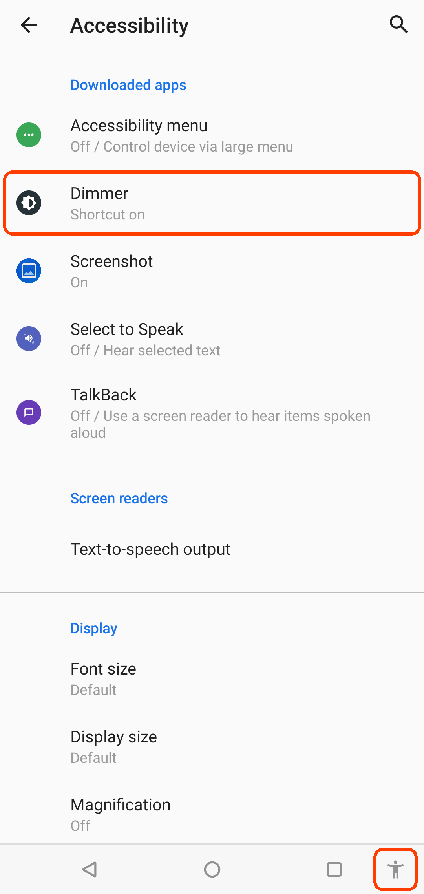
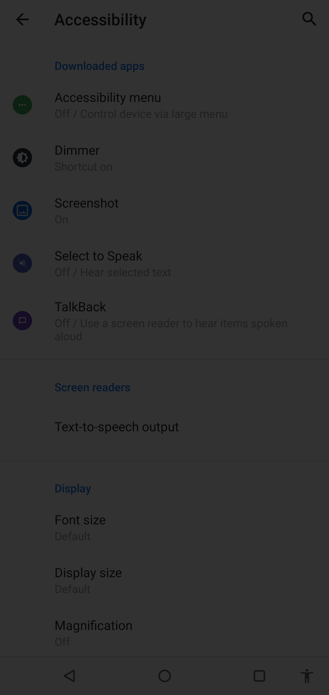
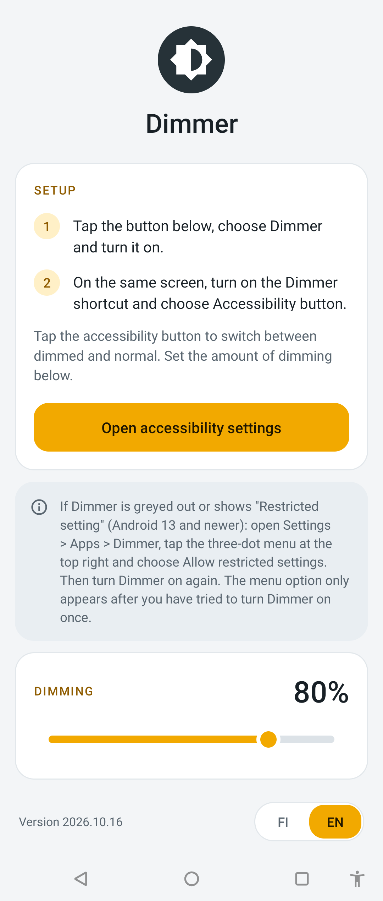
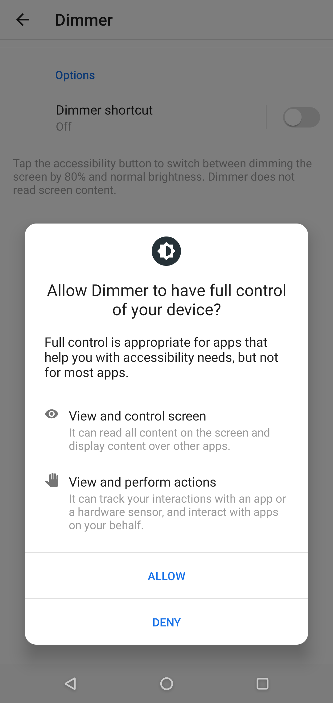

# Dimmer

A minimal Android app that dims the whole screen by 80% (adjustable) and back with one tap. Useful when sensitive content is briefly on screen in public or when you don't want to disturb others in a low light environment. You can toggle it with the **accessibility button**.

[Download](https://github.com/github-0/android-dimmer/releases/latest/download/app-release.apk) the APK from the releases page, or build it yourself.

<table>
<thead>
<tr>
<th width="34.5%" align="left">Dimmer enabled, accessibility button in the navigation bar</th>
<th width="34.5%" align="left">After tapping the accessibility button</th>
<th width="31%" align="left">The app's setup screen</th>
</tr>
</thead>
<tbody>
<tr>
<td></td>
<td></td>
<td></td>
</tr>
</tbody>
</table>

## Source files

| File | Role |
|---|---|
| `app/src/main/java/com/example/dimmer/DimService.kt` | Accessibility service. Receives accessibility button taps and adds/removes the overlay window (`TYPE_ACCESSIBILITY_OVERLAY`). |
| `app/src/main/java/com/example/dimmer/MainActivity.kt` | Setup screen with instructions and a shortcut to accessibility settings. |
| `app/src/main/res/xml/dim_service.xml` | Accessibility service config: what the service asks the system for. |
| `app/src/main/AndroidManifest.xml` | Commented to explain what the app needs vs. what the system warnings say. |

There are no library dependencies. `minSdk` is 30 (Android 11).

## Build and install

Build with Android Studio's bundled JDK:

```
JAVA_HOME=~/android-studio/jbr ./gradlew assembleDebug
adb install -r app/build/outputs/apk/debug/app-debug.apk
```


## Permissions

Notes from looking into the permissions (10/2026), so the topic doesn't need re-researching.

### What the app actually requests

- **No Android permissions.** The manifest has no `<uses-permission>` entries. `adb shell dumpsys package com.example.dimmer` shows no install-time or runtime permissions.
- `BIND_ACCESSIBILITY_SERVICE` in the manifest is **not** a permission the app holds. It means only the system can bind to the service.
- The only thing the user grants is **turning on the accessibility service**.

What the service config (`dim_service.xml`) asks for:

| Capability | Requested | Meaning |
|---|---|---|
| `flagRequestAccessibilityButton` | Yes | Receive accessibility button taps. |
| `canRetrieveWindowContent` | No | Can't read what's on screen. |
| `accessibilityEventTypes` | No (defaults to 0, checked in SDK source) | Receives no events: doesn't see taps, typing or app switches. |
| `canPerformGestures` | No | Can't tap or swipe on the user's behalf. |
| `isAccessibilityTool` | No | See below. |

Any accessibility service may add an accessibility overlay window without extra config. That window type is trusted, so touches pass through at any opacity.

### The "Allow Dimmer to have full control of your device?" dialog

When enabling the app as accessibility service, the dialog lists "View and control screen" and "View and perform actions". **Dimmer can't change or narrow this text.** In the Android 11 Settings source (`AccessibilityServiceWarning.java`, `android11-release`), the dialog is a static layout: only the app name and icon vary, and it doesn't look at the service's capabilities. It describes the worst case for any accessibility service, not what Dimmer requests.




### Restricted settings (Android 13+)

On newer phones the service shows as greyed out ("Controlled by restricted settings") and tapping it says the permission is blocked. This applies to apps installed outside an app store, e.g. from a downloaded APK. Android 11 has no such rule.

Fix: **Settings > Apps > Dimmer > App info > three-dot menu > Allow restricted settings**, confirm, then turn the service on. The menu option only appears after trying to enable the service once. Android 15+ may add an extra confirmation step.

Installing with `adb install` is believed not to trigger the restriction, but this wasn't confirmed on Android 17.

### Advanced Protection (Android 17)

A separate, stricter mode. When it's on, reports say only services declaring `isAccessibilityTool="true"` may run, with no override. Dimmer doesn't currently declare it, so it would be blocked while Advanced Protection is on. The dialog seen on the Android 17 test phone was the ordinary restricted-settings one, not this.

### Should Dimmer declare `isAccessibilityTool`?

Currently not set. For a personally installed app there's no practical downside:

- **Pro:** passes Android 17 Advanced Protection (per reports).
- **Pro:** skips the reminder notification Android can post about 24 hours after a non-tool service is enabled (checked in AOSP `PolicyWarningUIController.java`).
- **Neutral:** on paper it gains access to views apps mark as `accessibilityDataSensitive` (e.g. password fields). Dimmer requests no content, events or gestures, so nothing changes in practice.
- **Neutral:** doesn't bypass restricted settings.
- **Neutral:** the attribute exists from API 31; Android 11 ignores it.
- **Con, only if published on Google Play:** Play accepts the flag only for apps whose primary purpose is helping people with disabilities, and requires a declaration form in Play Console. Low vision / light sensitivity is a plausible fit, but approval is Google's call.

### Alternative considered: "Display over other apps"

Using a `SYSTEM_ALERT_WINDOW` overlay instead of an accessibility service gives a much milder permission prompt. Rejected because:

- **No accessibility button**: only accessibility services can use it. The toggle would be the tile or a self-drawn floating button.
- **Status bar, navigation bar and keyboard stay bright**: `TYPE_APPLICATION_OVERLAY` sits below them (per the `WindowManager` docs).
- **80% is the ceiling on Android 12+**: touches only pass through such an overlay at window alpha ≤ 0.8, so it could never go darker.

### Sources

- [Google Help: Allow restricted settings](https://support.google.com/android/answer/12623953?hl=en-NZ)
- [Google Play Console Help: Use of the AccessibilityService API](https://support.google.com/googleplay/android-developer/answer/10964491?hl=en)
- [The Hacker News: Android 17 Advanced Protection locks accessibility services](https://thehackernews.com/2026/10/android-17-advanced-protection-locks.html)
- [Android Police: Android 17's Advanced Protection mode](https://www.androidpolice.com/advanced-protection-mode-week-test/)
- AOSP: `packages/apps/Settings/.../AccessibilityServiceWarning.java` (android11-release), `frameworks/base/services/accessibility/.../PolicyWarningUIController.java` (main)
- Android SDK sources: `WindowManager.LayoutParams` (overlay layering, untrusted touch rules), `AccessibilityServiceInfo` (config defaults)
